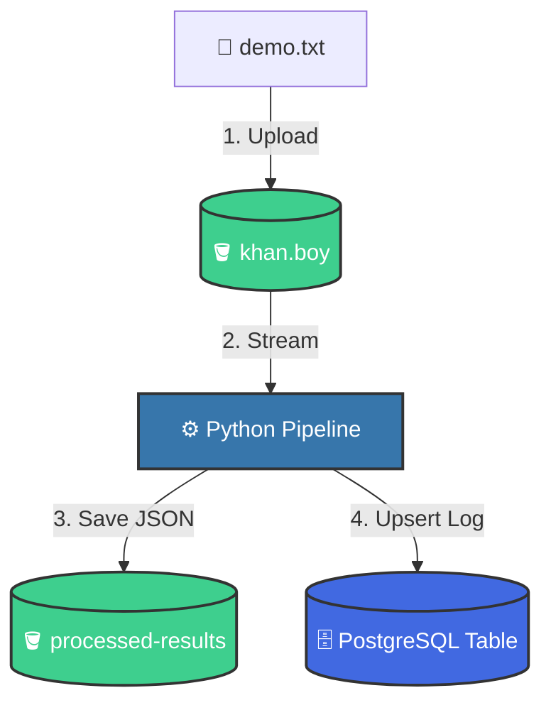

<div align="center">

# ⚡ CloudDoc-Pipeline
### Automated Cloud Document Processing & Relational Observability Pipeline

[](https://python.org)
[](https://supabase.com)
[](https://postgresql.org)
[](#)

<p align="center">
  <b>A lightweight, event-driven cloud pipeline designed to automate document ingestion, extract in-memory text metrics, generate structured JSON reports, and synchronize real-time state with PostgreSQL.</b>
</p>

[Key Features](#-key-features) • [Architecture](#-architecture) • [Database Schema](#-database-schema) • [Quick Start](#-quick-start) • [Author](#-author)

---

</div>

## 📌 Executive Summary

Manual file auditing and text metric calculations create bottlenecks in modern data workflows. This project delivers an end-to-end cloud pipeline that eliminates manual intervention by isolating raw ingestion and processed outputs into distinct cloud storage layers, running automated in-memory analytics, and maintaining fault-tolerant database logs.

---

## ✨ Key Features

- 🗄️ **Dual-Bucket Object Isolation:** Dedicated ingestion bucket (`khan.boy`) and analytics bucket (`processed-results`) preventing data overwrite.
- ⚡ **In-Memory Stream Processing:** Reads and parses documents directly in memory without cluttering local disk storage.
- 📊 **Instant Text Analytics:** Automatically extracts quantitative metrics (line count, word count, character count).
- 🛡️ **Conflict-Free State Sync:** Employs smart `upsert` queries to ensure zero duplicate primary key collisions during repeated file processing.
- 🔒 **Enterprise-Grade Auth:** Connects via Supabase Service Role Secret Key for secure background execution.

---

## 🏗️ System Architecture & Live Data Flow



```text
 ┌───────────────────────┐
 │   Input: demo.txt     │
 └──────────┬────────────┘
            │ 1. Upload Event
            ▼
 ┌───────────────────────┐
 │  🪣 Bucket: khan.boy  │
 └──────────┬────────────┘
            │ 2. Stream to Memory
            ▼
 ┌───────────────────────┐
 │  ⚙️ Python Pipeline   │ ──► [Lines: 1 | Words: 4 | Chars: 27]
 └──────────┬────────────┘
            │
      ┌─────┴─────────────────────────┐
      │ 3. Save JSON Report           │ 4. Sync State (Upsert)
      ▼                               ▼
┌──────────────────────────┐    ┌──────────────────────────┐
│ 🪣 processed-results     │    │ 🗄️ document_logs Table   │
│ (result_demo.txt.json)   │    │ (Status: PROCESSED)      │
└──────────────────────────┘    └──────────────────────────┘
```

---

## 📂 Cloud Storage Topology

| Bucket Name | Access Level | Purpose | File Formats |
| :--- | :--- | :--- | :--- |
| `khan.boy` | Private / Authenticated | Raw incoming file ingestion | `.txt`, `.csv` |
| `processed-results` | Private / Authenticated | Generated analytics reports | `.json` |

---

## 🗄️ Database Schema (`document_logs`)

```sql
CREATE TABLE document_logs (
    id BIGSERIAL PRIMARY KEY,
    file_name TEXT UNIQUE NOT NULL,
    status TEXT NOT NULL,
    word_count INT8 NOT NULL,
    created_at TIMESTAMPTZ DEFAULT NOW()
);
```

| Column | Type | Constraints | Description |
| :--- | :--- | :--- | :--- |
| `id` | `INT8` | `PRIMARY KEY`, `AUTO_INCREMENT` | Unique execution tracking identifier |
| `file_name` | `TEXT` | `UNIQUE` | Source document name |
| `status` | `TEXT` | `NOT NULL` | Lifecycle state (`PROCESSED` / `PENDING`) |
| `word_count` | `INT8` | `NOT NULL` | Extracted word count metric |
| `created_at` | `TIMESTAMPTZ`| `DEFAULT NOW()` | Timestamp of logging event |

---

## 📋 Sample Output (`result_demo.txt.json`)

```json
{
    "file_name": "demo.txt",
    "status": "COMPLETED",
    "lines": 1,
    "words": 4,
    "characters": 27
}
```

---

## 🚀 Quick Start

### 1. Clone Repository
```bash
git clone [https://github.com/khanboy7170-ux/cloud-document-pipeline.git](https://github.com/khanboy7170-ux/cloud-document-pipeline.git)
cd cloud-document-pipeline
```

### 2. Install Dependencies
```bash
pip install supabase
```

### 3. Configure Credentials
In `pipeline.py`, ensure your project parameters are defined:
```python
SUPABASE_URL = "[https://your-project.supabase.co](https://your-project.supabase.co)"
SUPABASE_KEY = "YOUR_SUPABASE_SERVICE_ROLE_KEY"
```

### 4. Execute Pipeline
```bash
python pipeline.py
```

---

## 🔮 Roadmap & Enhancements

- [x] Dual-bucket cloud storage segregation
- [x] In-memory text parsing & JSON report generator
- [x] Fault-tolerant PostgreSQL upsert logging
- [ ] Serverless Edge Function triggers (zero manual script execution)
- [ ] Multi-format OCR integration (PDF & image parsing)
- [ ] LLM-based abstractive summary generation

---

## 👨‍💻 Author

**Mohammed Imran**  
🎓 *B.Tech in Computer Science & Engineering (Artificial Intelligence)*  
🏫 *Arya Institute of Engineering & Technology, Jaipur*  

---

<div align="center">
  <sub>Built with ❤️ using Python & Supabase. Star ⭐ this repository if you found it useful!</sub>
</div>