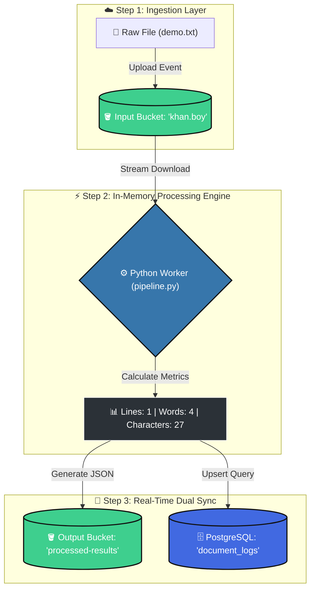
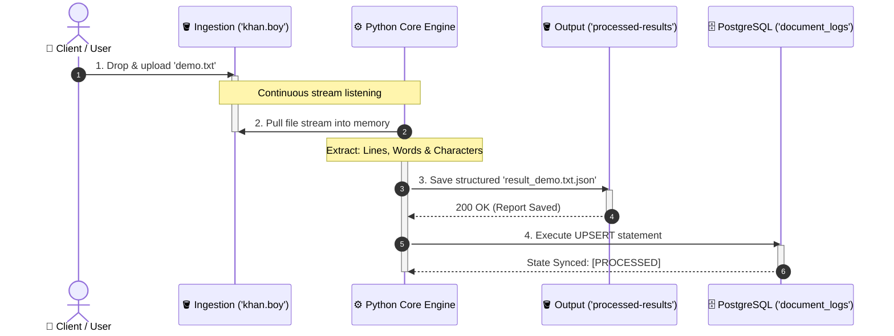

<div align="center">

# ⚡ CloudDoc-Pipeline
### Automated Cloud Document Processing & Relational Observability Pipeline

[](https://python.org)
[](https://supabase.com)
[](https://postgresql.org)
[](#)

<p align="center">
  <b>A lightweight, event-driven cloud pipeline designed to automate document ingestion, extract in-memory text metrics, generate structured JSON reports, and synchronize real-time state with PostgreSQL.</b>
</p>

[Key Features](#-key-features) • [Architecture](#-architecture) • [Database Schema](#-database-schema) • [Quick Start](#-quick-start) • [Author](#-author)

---

</div>

## 📌 Executive Summary

Manual file auditing and text metric calculations create bottlenecks in modern data workflows. This project delivers an end-to-end cloud pipeline that eliminates manual intervention by isolating raw ingestion and processed outputs into distinct cloud storage layers, running automated in-memory analytics, and maintaining fault-tolerant database logs.

---

## ✨ Key Features

- 🗄️ **Dual-Bucket Object Isolation:** Dedicated ingestion bucket (`khan.boy`) and analytics bucket (`processed-results`) preventing data overwrite.
- ⚡ **In-Memory Stream Processing:** Reads and parses documents directly in memory without cluttering local disk storage.
- 📊 **Instant Text Analytics:** Automatically extracts quantitative metrics (line count, word count, character count).
- 🛡️ **Conflict-Free State Sync:** Employs smart `upsert` queries to ensure zero duplicate primary key collisions during repeated file processing.
- 🔒 **Enterprise-Grade Auth:** Connects via Supabase Service Role Secret Key for secure background execution.

---

## 🏗️ System Architecture & Live Data Flow

<div align="center">



</div>

### 🔄 End-to-End Execution Trace



---

## 📂 Cloud Storage Topology

| Bucket Name | Access Level | Purpose | File Formats |
| :--- | :--- | :--- | :--- |
| `khan.boy` | Private / Authenticated | Raw incoming file ingestion | `.txt`, `.csv` |
| `processed-results` | Private / Authenticated | Generated analytics reports | `.json` |

---

## 🗄️ Database Schema (`document_logs`)

```sql
CREATE TABLE document_logs (
    id BIGSERIAL PRIMARY KEY,
    file_name TEXT UNIQUE NOT NULL,
    status TEXT NOT NULL,
    word_count INT8 NOT NULL,
    created_at TIMESTAMPTZ DEFAULT NOW()
